# Informe final — Sistema Web Full Stack Nova Salud

**Propuesta de Sistema Web Full Stack para la Automatización de la Gestión de Inventario en la Botica Nova Salud**

- **Institución:** SENATI
- **Carrera:** Ingeniería Software con IA
- **Curso:** Fullstack Developer Software (PIAD-527)
- **Instructor:** Morales Carlos, Aldo Omar
- **Ciclo:** V semestre — Perú, 2026
- **Integrantes (Grupo 1):** Gil Toribio, Jeff Steven; Loayza Manchego, Cesar Rosendo; Martel Milla, James; Najarro Mejia, Jhonatan Jhon; Pineda Morales, Cristhian Abraham

## Índice

- [Introducción](#introducción)
- [1. Generalidades de la empresa](#1-generalidades-de-la-empresa)
  - [Razón social](#razón-social)
  - [Giro del negocio](#giro-del-negocio)
  - [Productos y mercado](#productos-y-mercado)
  - [Misión y visión del proyecto](#misión-y-visión-del-proyecto)
- [2. Realidad problemática](#2-realidad-problemática)
- [3. Objetivos](#3-objetivos)
  - [3.1. Objetivo general](#31-objetivo-general)
  - [3.2. Objetivos específicos](#32-objetivos-específicos)
- [4. Justificaciones](#4-justificaciones)
  - [4.1. Justificación tecnológica](#41-justificación-tecnológica)
  - [4.2. Justificación económica](#42-justificación-económica)
  - [4.3. Justificación social](#43-justificación-social)
  - [4.4. Justificación operativa](#44-justificación-operativa)
  - [4.5. Justificación de seguridad](#45-justificación-de-seguridad)
- [5. Conceptos fundamentales](#5-conceptos-fundamentales)
- [6. Tecnologías involucradas](#6-tecnologías-involucradas)
  - [6.1. Tecnologías de desarrollo web](#61-tecnologías-de-desarrollo-web)
  - [6.2. Tecnologías de base de datos](#62-tecnologías-de-base-de-datos)
  - [6.3. Tecnologías de seguridad y comunicación](#63-tecnologías-de-seguridad-y-comunicación)
- [7. Propuesta del caso](#7-propuesta-del-caso)
  - [7.1. Diagrama Actual](#71-diagrama-actual)
  - [7.2. Diagrama Propuesto](#72-diagrama-propuesto)
  - [7.3. Solución](#73-solución)
- [8. Implementación del Sistema Web](#8-implementación-del-sistema-web)
  - [8.1. Arquitectura de la Solución](#81-arquitectura-de-la-solución)
  - [8.2. Backend, API REST y Base de Datos](#82-backend-api-rest-y-base-de-datos)
  - [8.3. Frontend e Integración con la API](#83-frontend-e-integración-con-la-api)
  - [8.4. Gestión Colaborativa con Jira y GitHub](#84-gestión-colaborativa-con-jira-y-github)
  - [8.5. Pruebas y validación](#85-pruebas-y-validación)
- [9. Conclusiones](#9-conclusiones)
- [10. Recomendaciones](#10-recomendaciones)
- [11. Referencias bibliográficas](#11-referencias-bibliográficas)

## Introducción

La botica Nova Salud se encuentra ubicada en una zona comercial con alta demanda de medicamentos y productos farmacéuticos. El incremento de clientes ha hecho más visibles las limitaciones del proceso actual de control de inventario y registro de ventas, debido a que estas operaciones se realizan manualmente. Como consecuencia, pueden producirse registros incorrectos de stock, desabastecimiento de productos y tiempos de espera elevados durante la atención.

Ante esta situación, se propone desarrollar un software web full stack para centralizar la información de productos, existencias y ventas. La solución estará conformada por un frontend desarrollado con React, un backend desarrollado con Node.js y JavaScript, y una base de datos relacional. El frontend consumirá los servicios del backend, mientras que el backend gestionará las reglas de negocio y la persistencia de los datos. Esta separación permite construir una solución organizada, mantenible y alineada con los requerimientos técnicos del curso.

El sistema buscará facilitar la consulta de productos, el control de stock, el registro de ventas y la emisión de alertas de reposición. También se considerará la seguridad de los datos, una interfaz intuitiva y la trazabilidad del trabajo mediante Jira y GitHub. El desarrollo se organizará en un proyecto Scrum, con tareas asignadas por integrante y contribuciones verificables tanto en backend como en frontend.

## 1. Generalidades de la empresa

### Razón social

Para el caso práctico, la organización será denominada Botica Nova Salud. El material proporcionado la describe como una botica ubicada en una zona comercial de alta demanda de medicamentos y productos farmacéuticos. No se ha proporcionado una razón social legal, RUC ni dirección específica; por ello, estos datos no se incluirán como si fueran información real.

### Giro del negocio

Nova Salud pertenece al sector farmacéutico minorista. Su operación incluye la recepción y organización de productos, el control de existencias, la venta de medicamentos y productos complementarios, y la atención directa a los clientes.

### Productos y mercado

La botica comercializa medicamentos y productos farmacéuticos. Su mercado objetivo está conformado por personas que requieren atención rápida y disponibilidad confiable de productos en una zona comercial con alta afluencia. El sistema propuesto se enfocará en mejorar el proceso interno de inventario y ventas para contribuir a una atención más ágil.

### Misión y visión del proyecto

Como el caso práctico no entrega una misión y visión oficial de la botica, se propone utilizar estas declaraciones únicamente como referencia académica y validarlas con el docente si solicita información institucional real.

**Misión propuesta:** brindar atención farmacéutica eficiente mediante la disponibilidad organizada de productos, el control responsable del inventario y un servicio cercano al cliente.

**Visión propuesta:** consolidarse como una botica reconocida por la rapidez de atención, la confiabilidad de su inventario y el uso responsable de herramientas digitales para mejorar su operación.

## 2. Realidad problemática

Actualmente, Nova Salud realiza el control de stock y la atención de ventas de manera manual. Esta forma de trabajo aumenta el riesgo de que las existencias registradas no coincidan con los productos disponibles físicamente. Cuando esto ocurre, el personal puede ofrecer productos agotados, retrasar la búsqueda de alternativas o descubrir la falta de stock recién al momento de concretar una venta.

El proceso manual también dificulta conocer oportunamente qué productos requieren reposición. Sin alertas automáticas basadas en un stock mínimo, los responsables dependen de revisiones periódicas y de la memoria del personal. Esto favorece los desabastecimientos, especialmente en productos de mayor demanda.

Además, el registro manual de ventas puede hacer más lenta la atención y limitar el acceso inmediato a información útil para la gestión. Sin un registro centralizado, se dificulta identificar productos más vendidos, revisar el movimiento de inventario y tomar decisiones de compra con datos consistentes.

**Problemas identificados**

- Control de inventario manual, con riesgo de errores en cantidades y disponibilidad.

- Ausencia de actualización automática del stock después de una venta.

- Falta de alertas para productos que alcanzan o bajan del stock mínimo.

- Registro de ventas con mayor tiempo de atención.

- Información dispersa o no disponible de forma inmediata para consulta.

- Dificultad para revisar movimientos de inventario y analizar ventas.

**Consecuencias**

- Posibles desabastecimientos de productos solicitados por clientes.

- Tiempos de espera mayores durante la atención.

- Pérdida de oportunidades de venta cuando el producto no está disponible.

- Riesgo de compras tardías o innecesarias por falta de datos actualizados.

- Menor capacidad para supervisar la operación mediante información centralizada.

## 3. Objetivos

### 3.1. Objetivo general

Desarrollar una propuesta de software web full stack para gestionar de manera centralizada el inventario y las ventas de la botica Nova Salud, con el fin de reducir errores de stock, prevenir desabastecimientos y agilizar la atención al cliente.

### 3.2. Objetivos específicos

1.  Implementar el registro, consulta, actualización y control de productos e inventario.

2.  Incorporar una actualización de stock asociada al registro de cada venta.

3.  Diseñar alertas para identificar productos cuyo stock alcance o sea menor al mínimo configurado.

4.  Implementar un módulo de ventas que agilice el registro de productos y el cálculo del total.

5.  Diseñar una interfaz web intuitiva para el personal autorizado de la botica.

6.  Aplicar autenticación y control de acceso de acuerdo con los roles definidos para el sistema.

7.  Diseñar una arquitectura con frontend en React, backend en Node.js con JavaScript y base de datos relacional.

8.  Gestionar el desarrollo mediante Jira y GitHub, asegurando tareas y contribuciones trazables de cada integrante.

## 4. Justificaciones

### 4.1. Justificación tecnológica

La solución se desarrollará como una aplicación web full stack. React se utilizará para construir una interfaz dinámica y organizada por componentes. Node.js con JavaScript se utilizará en el backend para exponer una API que reciba las solicitudes del frontend, ejecute las validaciones necesarias y se conecte con la base de datos relacional seleccionada por el equipo. Esta separación responde a la exigencia de trabajar con dos proyectos que se comuniquen: frontend–backend y backend–base de datos.

La base de datos se implementó en MySQL 8.4, alojada en Aiven (cloud), con conexión cifrada SSL. El script de creación y los datos iniciales están en la carpeta database/ del repositorio. Se eligió por su facilidad de implementación, el conocimiento previo del equipo y su compatibilidad con el backend mediante la librería mysql2. El repositorio contiene el script database/nova_salud.sql y el modelo entidad-relación en docs/diagramas/.

El uso de GitHub permitirá mantener el historial de cambios en un único repositorio (Group-1-Nova-Salud) con las carpetas backend/ y frontend/. Jira, mediante una plantilla Scrum, permitirá organizar el backlog, asignar responsables, dar seguimiento a las tareas y vincular cada cambio del código con una actividad del proyecto.

### 4.2. Justificación económica

El sistema puede contribuir a disminuir costos indirectos provocados por errores de inventario, compras no planificadas y pérdida de ventas por falta de productos. Al disponer de alertas de bajo stock y registros centralizados, el personal podrá revisar con mayor rapidez qué productos requieren reposición.

Esta propuesta no afirma una reducción porcentual de costos, porque dicha cifra requeriría mediciones del funcionamiento real antes y después de implementar el sistema. En una etapa posterior, podrían medirse indicadores como ventas perdidas por desabastecimiento, diferencias de inventario y tiempo promedio de atención.

### 4.3. Justificación social

Una atención más ágil y una mayor disponibilidad de productos pueden beneficiar a los clientes de Nova Salud, particularmente cuando necesitan medicamentos o productos de uso frecuente. El sistema también puede ayudar al personal al reducir la dependencia de registros manuales, facilitar la consulta de existencias y estandarizar el registro de ventas.

La solución no reemplaza el criterio profesional del personal farmacéutico ni debe considerarse una herramienta de diagnóstico o prescripción. Su función se limita a apoyar la organización operativa de inventario y ventas.

### 4.4. Justificación operativa

El software centralizará las actividades principales vinculadas al inventario y a las ventas. El personal autorizado podrá iniciar sesión, consultar productos, registrar ventas y revisar alertas de stock. Los responsables de administración podrán gestionar productos, categorías, proveedores, stock mínimo y reportes básicos, según el rol asignado a cada usuario.

Al ser una aplicación web, la solución podrá utilizarse desde equipos con navegador web y conexión al entorno donde se publique la aplicación. Se deberá definir el procedimiento de respaldo de datos, las responsabilidades de cada rol y la capacitación mínima para asegurar un uso adecuado.

### 4.5. Justificación de seguridad

El caso práctico exige seguridad en los datos. Por ello, la propuesta debe incorporar autenticación para controlar el acceso, validaciones en frontend y backend, manejo seguro de credenciales mediante variables de entorno y una política de permisos por rol.

Las contraseñas se almacenan con hash bcrypt. El endpoint de login consulta la base, compara con bcrypt.compare y devuelve 401 cuando las credenciales no coinciden.

## 5. Conceptos fundamentales

- **Aplicación web:** software accesible mediante un navegador web, que permite a los usuarios realizar operaciones sin instalar una aplicación nativa en cada dispositivo.

- **Arquitectura full stack:** enfoque de desarrollo que integra frontend, backend y base de datos. El frontend presenta la interfaz, el backend contiene la lógica de negocio y la base de datos conserva la información de forma persistente.

- **Frontend:** capa con la que interactúa el usuario. Este proyecto está desarrollándose con React, Vite y Tailwind CSS y permitirá visualizar información, completar formularios y solicitar operaciones al backend.

- **Backend:** capa que recibe solicitudes del frontend, valida datos, aplica reglas de negocio y se comunica con la base de datos. Este proyecto se implementó con Node.js, JavaScript y Express

- **API REST:** interfaz que permite la comunicación entre aplicaciones mediante solicitudes HTTP. El frontend utilizará endpoints del backend para consultar, crear, actualizar o eliminar información de acuerdo con los permisos del usuario.

- **Base de datos relacional:** sistema de almacenamiento que organiza la información en tablas relacionadas. Permitirá guardar datos de productos, categorías, usuarios, ventas y detalle de ventas, manteniendo relaciones consistentes entre ellos.

- **Inventario:** conjunto de productos disponibles para venta y sus cantidades. Su control requiere registrar entradas, salidas y ajustes para conocer la disponibilidad real.

- **Stock mínimo:** cantidad mínima definida para un producto. Cuando la existencia llega o baja de ese valor, el sistema debe generar una alerta de reposición.

- **Punto de venta:** módulo que permite registrar una venta, calcular el importe total y descontar del inventario las unidades vendidas.

- **Trazabilidad:** capacidad de identificar el historial de una operación. En el proyecto se relaciona con registrar ventas y movimientos de inventario, así como con vincular tareas de Jira con ramas, commits y pull requests en GitHub.

- **Autenticación:** proceso mediante el cual el sistema verifica la identidad de un usuario antes de permitir su acceso.

- **Autorización:** proceso que determina qué operaciones puede realizar un usuario autenticado según su rol, por ejemplo, administrador o vendedor.

- **Scrum:** marco de trabajo ágil que organiza el trabajo en periodos cortos y utiliza elementos como backlog, tareas priorizadas y responsables. En este proyecto, Jira será la herramienta para gestionar dichas actividades.

- **Control de versiones:** práctica que permite registrar y administrar los cambios del código fuente. GitHub se utiliza para mantener el repositorio del proyecto, con ramas por tarea, pull requests y revisión entre integrantes.

## 6. Tecnologías involucradas

### 6.1. Tecnologías de desarrollo web

| **Tecnología** | **Uso implementado** |
|----|----|
| **React** | Desarrollo del frontend como aplicación web de una sola página, con componentes, formularios, navegación y consumo de la API. |
| **Node.js** | Ejecución del backend y creación de servicios para la lógica de negocio. |
| **JavaScript** | Lenguaje obligatorio para el backend y lenguaje principal de desarrollo del proyecto. |
| **Express** | Framework (Express 5) utilizado para estructurar rutas, controladores, validaciones y servicios REST en el backend. |
| **HTML y CSS** | Estructura y estilos de la interfaz; se utilizó Tailwind CSS 4. |
| **Git y GitHub** | Control de versiones, repositorio único con carpetas frontend/ y backend/, ramas, commits, pull requests y revisión colaborativa. |
| **Jira** | Planificación Scrum, backlog, asignación de responsables y seguimiento de tareas. |

**Ramas y pull requests integrados en el repositorio de GitHub del proyecto.**

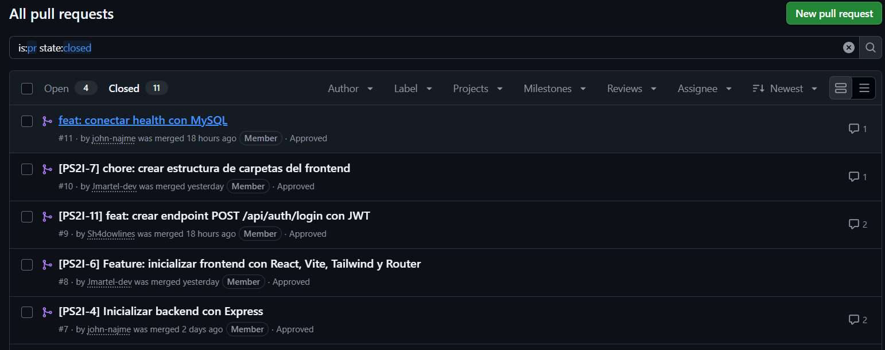

**React para frontend y Node.js con JavaScript para backend son obligatorios para el entregable; las tecnologías listadas fueron utilizadas en la implementación del avance.**

### 6.2. Tecnologías de base de datos

| **Tecnología o elemento** | **Aplicación en la propuesta** |
|----|----|
| **Motor de base de datos relacional** | MySQL 8.4 en Aiven, con conexión SSL obligatoria. |
| **Modelo entidad-relación** | Representa las entidades, atributos y relaciones del sistema; está en docs/diagramas/ (T71). |
| **Script SQL** | El archivo database/nova_salud.sql crea las 8 tablas, sus relaciones y los datos iniciales. |
| **Consultas parametrizadas** | Las consultas del backend usan parámetros (?) de mysql2 en lugar de concatenar valores en el SQL. |

**Tabla productos con datos de prueba en MySQL, alojada en Aiven.**

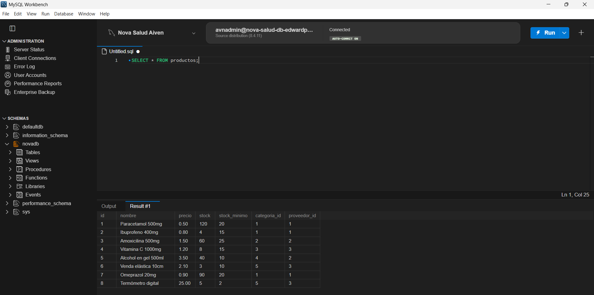

### 6.3. Tecnologías de seguridad y comunicación

| **Tecnología o práctica** | **Uso implementado** |
|----|----|
| **HTTP/HTTPS** | Comunicación entre el frontend y la API del backend. |
| **API REST** | Exposición de operaciones para productos, inventario, ventas, usuarios y alertas. |
| **Hash de contraseñas** | Protección de contraseñas antes de almacenarlas en la base de datos. |
| **Variables de entorno** | Separación de datos sensibles, como credenciales de base de datos y claves de configuración. |
| **Control de acceso por roles** | Restricción de acciones según el perfil del usuario. |
| **Validación de datos** | Verificación de campos en frontend y backend antes de procesar operaciones. |

**Sprint activo en Jira con tareas asignadas por integrante.**

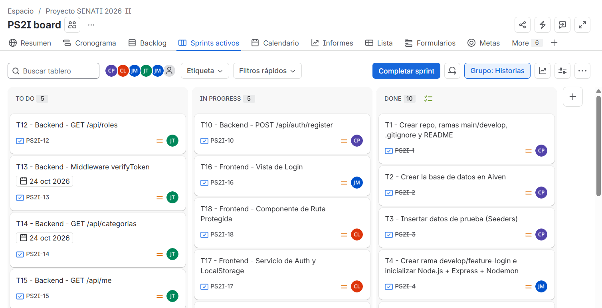

**Prueba del endpoint de login en Postman, con respuesta 200 y token JWT.**

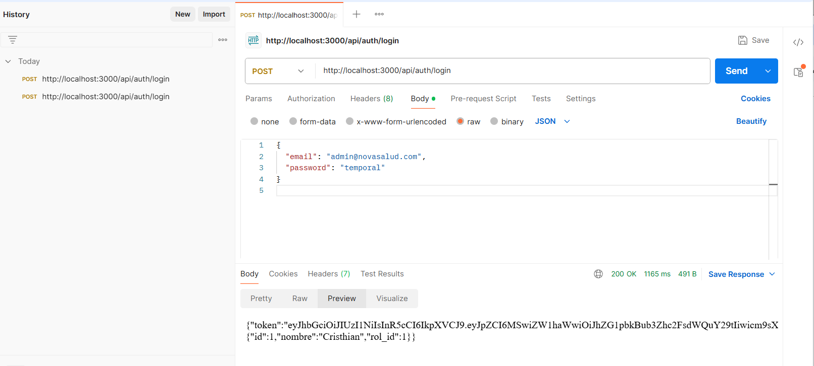

## 7. Propuesta del caso

En esta sección se compara el proceso de venta e inventario que la botica realizaba de forma manual con el proceso que se implementó en el sistema web Nova Salud. Los diagramas permiten identificar en qué puntos se producían los errores y cómo el sistema los resuelve.

### 7.1. Diagrama Actual

Antes del sistema, la venta y el control de stock dependían de anotaciones manuales. El vendedor ubicaba el producto, calculaba el total, cobraba y registraba la venta en un cuaderno; la reposición se decidía en revisiones periódicas del stock. Cada paso manual es un punto de error: el stock anotado puede no coincidir con el real, el cálculo puede fallar y la falta de un producto se detecta tarde.

**Proceso actual de venta y control de stock (manual).**

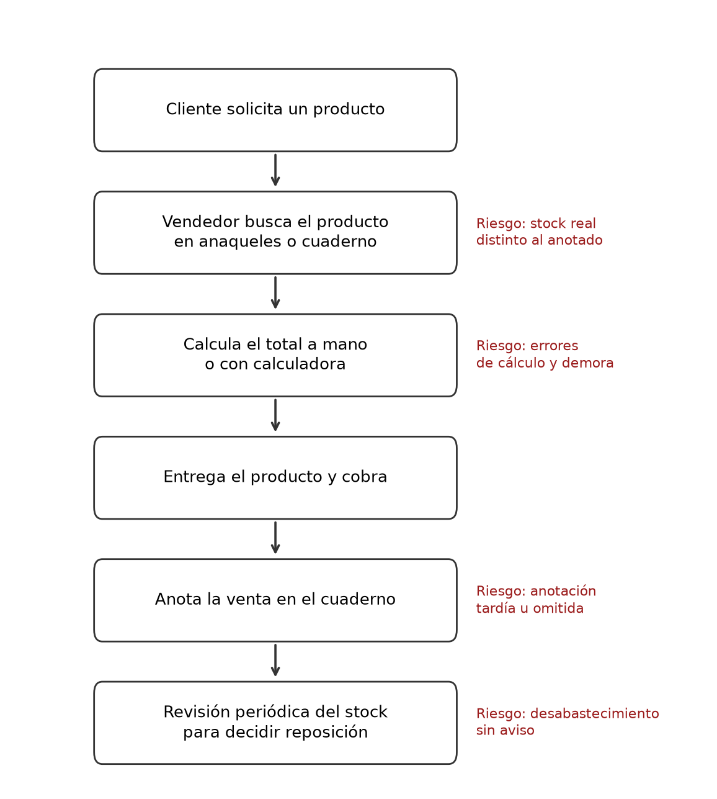

### 7.2. Diagrama Propuesto

Con el sistema, el vendedor inicia sesión, busca el producto en el punto de venta (POS) con el stock actualizado, agrega los productos al carrito y cobra. El backend registra la venta dentro de una transacción: descuenta el stock, guarda el detalle y registra el movimiento de salida. Las alertas y el dashboard muestran de inmediato los productos que llegaron a su stock mínimo. A la derecha de cada paso se indica el endpoint o la tabla que lo respalda.

**Proceso propuesto e implementado en Nova Salud.**

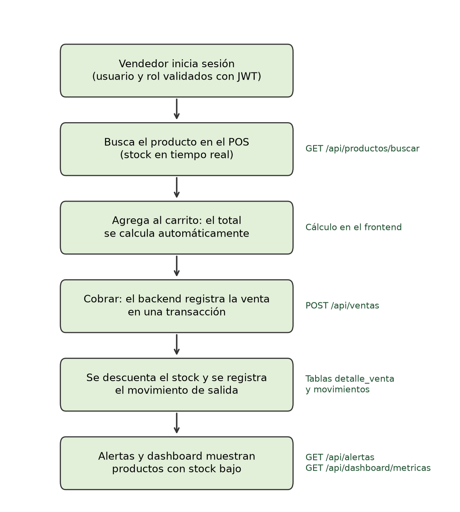

### 7.3. Solución

La solución es una aplicación web full stack formada por un frontend en React, un backend en Node.js con Express que expone una API REST y una base de datos MySQL alojada en Aiven. Los módulos implementados en el repositorio son los siguientes:

| **Módulo** | **Funcionalidad implementada** | **Endpoint principal** |
|----|----|----|
| **Autenticación** | Registro e inicio de sesión con contraseña cifrada (bcryptjs) y token JWT; consulta del usuario autenticado. | /api/auth, /api/me |
| **Productos e inventario** | Listar, buscar por nombre, crear, editar y eliminar productos; ver categoría y stock crítico. | /api/productos |
| **Categorías** | Listar, crear y editar categorías. | /api/categorias |
| **Proveedores** | Listar, crear y eliminar proveedores (con validación de productos asociados). | /api/proveedores |
| **Punto de venta (POS)** | Buscador, carrito, cobro y recibo simple. | /api/ventas |
| **Ventas** | Registrar venta con transacción, listar ventas, ventas del día y detalle por id. | /api/ventas |
| **Movimientos** | Historial de entradas y salidas de stock con filtros por fecha. | /api/movimientos |
| **Alertas** | Productos con stock igual o menor al mínimo. | /api/alertas |
| **Dashboard** | Tarjetas de métricas y gráfico de ventas de la semana (Recharts). | /api/dashboard |
| **Usuarios** | Activar y desactivar usuarios (backend). La vista de gestión de usuarios está pendiente (T59). | /api/usuarios/:id/estado |

Los actores y sus casos de uso se resumen en el diagrama de casos de uso del repositorio (T74): el administrador gestiona productos, categorías, proveedores y usuarios, mientras que el vendedor registra ventas y consulta el inventario y las alertas.

**Diagrama de casos de uso (docs/diagramas).**

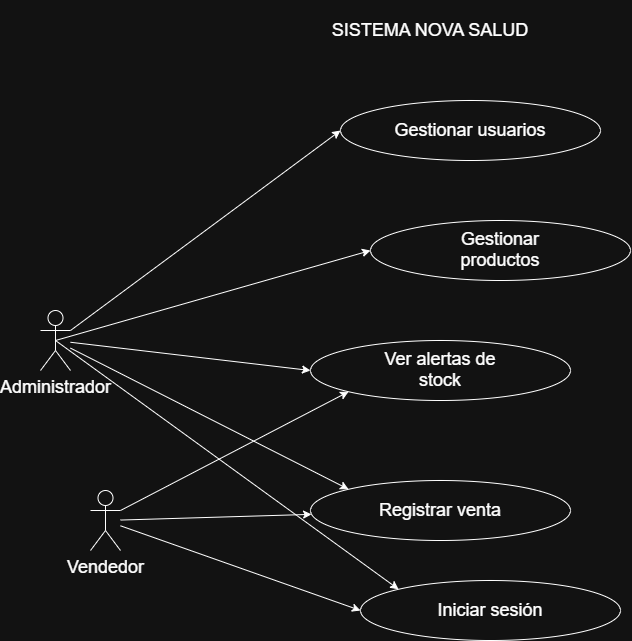

## 8. Implementación del Sistema Web

El código se encuentra en el repositorio de GitHub 2026-II-Senati/Group-1-Nova-Salud. Al 3 de noviembre de 2026, la rama develop contiene 202 commits y se han creado 71 pull requests. El repositorio está organizado en las siguientes carpetas:

| **Carpeta** | **Contenido** |
|----|----|
| **backend/** | API REST en Node.js con Express: rutas, controladores, middleware, conexión a MySQL, Dockerfile y casos de prueba de autenticación en YAML. |
| **frontend/** | Aplicación React con Vite, Tailwind CSS y React Router: páginas, componentes y servicios. |
| **database/** | Script nova_salud.sql con la creación de las 8 tablas, sus relaciones y datos de prueba. |
| **docs/** | Contrato de la API, documento REST vs SOAP, diagramas (ER, arquitectura, secuencia, casos de uso) y manual de usuario. |
| **documentacion/** | Reportes de pruebas de caja negra (T48) y de control de acceso del rol vendedor (T60). |
| **postman/** | Colección de pruebas de los endpoints de productos. |

### 8.1. Arquitectura de la Solución

El sistema sigue una arquitectura de tres capas. El navegador ejecuta el frontend en React, que consume la API mediante peticiones HTTP con formato JSON. El backend en Express recibe las peticiones, aplica la lógica de negocio y consulta la base de datos mediante un pool de conexiones de mysql2. La base de datos MySQL 8.4 se encuentra en Aiven y la conexión se realiza con SSL.

**Diagrama de arquitectura (docs/diagramas).**

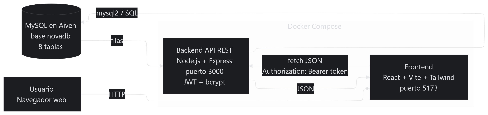

- **Capa de presentación:** React 19 con Vite 8, Tailwind CSS 4, React Router 7 y Recharts.

- **Capa de negocio:** Node.js con Express 5, jsonwebtoken, bcryptjs, cors y dotenv. El punto de entrada es backend/src/server.js, que además expone /health para verificar la conexión con la base de datos.

- **Capa de datos:** MySQL 8.4 en Aiven con 8 tablas relacionadas.

- **Contenedores:** el Dockerfile del backend (node:20-alpine, T61), el Dockerfile del frontend (T62) y el docker-compose.yml (T63) están integrados en develop; la prueba de docker-compose up (T64) sigue en curso.

**Ejecución.** En desarrollo, el backend se inicia con npm run dev (nodemon) y queda activo en http://localhost:3000; el frontend se inicia con Vite en http://localhost:5173. Con Docker, el proyecto nova-salud se levanta como un grupo de contenedores en Docker Desktop.

**Terminales: API activa en el puerto 3000 y frontend Vite en el puerto 5173.**

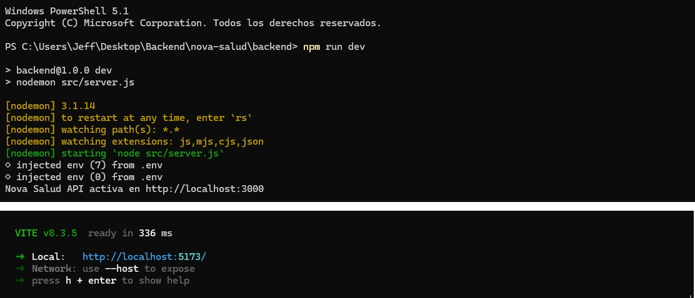

**Docker Desktop: proyecto nova-salud en ejecución.**

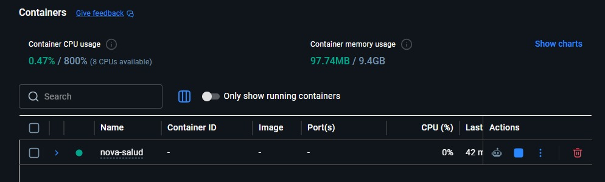

### 8.2. Backend, API REST y Base de Datos

El backend expone una API REST documentada en docs/contrato-api.md. La siguiente tabla resume los endpoints que existen en el código:

| Recurso | Métodos y rutas | Descripción |
|----|----|----|
| **Autenticación** | `POST /api/auth/register` `POST /api/auth/login` | Registra usuarios con contraseña cifrada y devuelve un token JWT al iniciar sesión. |
| **Usuario actual** | `GET /api/me` | Devuelve los datos del usuario del token (requiere verifyToken). |
| **Usuarios** | `PUT /api/usuarios/:id/estado` | Activa o desactiva un usuario (requiere verifyToken). |
| **Roles** | `GET /api/roles` | Lista los roles disponibles. |
| **Productos** | `GET /api/productos` `GET /api/productos/buscar` `POST`, `PUT /:id`, `DELETE /:id` | Listado con categoría, búsqueda por nombre y CRUD de productos. |
| **Categorías** | `GET`, `POST`, `PUT /:id` | Listado, creación y edición de categorías. |
| **Proveedores** | `GET`, `POST`, `DELETE /:id` | Listado, creación y eliminación de proveedores. |
| **Ventas** | `POST /api/ventas` `GET /api/ventas` `GET /api/ventas/hoy` `GET /api/ventas/:id` | Registro de venta con transacción, historial, ventas del día y detalle. |
| **Movimientos** | `GET /api/movimientos` | Historial de movimientos de stock con filtros por fecha. |
| **Alertas** | `GET /api/alertas` | Productos con stock igual o menor al stock mínimo. |
| **Dashboard** | `GET /api/dashboard/metricas` `GET /api/dashboard/ventas-semana` | Métricas generales y ventas de los últimos días. |

**Registro de ventas con transacción.** El endpoint POST /api/ventas inicia una transacción, bloquea las filas de los productos con SELECT ... FOR UPDATE, valida que haya stock suficiente, inserta la venta y su detalle, descuenta el stock y registra un movimiento de tipo salida. Si algún paso falla, se ejecuta un rollback y no se guarda ningún cambio, lo que evita ventas parciales o stock negativo.

**Diagrama de secuencia: registrar venta (docs/diagramas).**

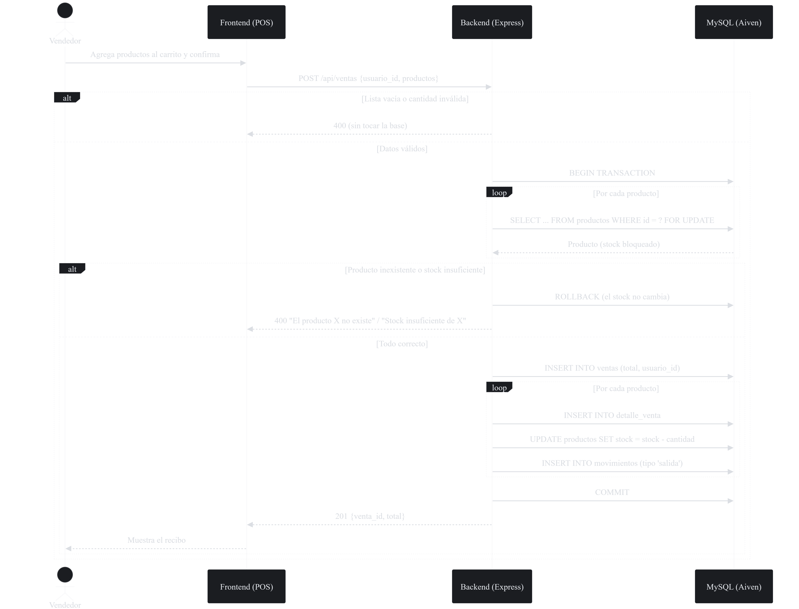

**Base de datos.** El script database/nova_salud.sql crea las tablas y sus claves foráneas:

| **Tabla** | **Contenido** |
|----|----|
| **roles** | Roles del sistema (administrador y vendedor). |
| **usuarios** | Usuarios con correo, contraseña cifrada, rol y estado. |
| **categorias** | Categorías de productos. |
| **proveedores** | Datos de los proveedores. |
| **productos** | Productos con precio, stock, stock mínimo, categoría y proveedor. |
| **ventas** | Cabecera de cada venta: usuario, fecha y total. |
| **detalle_venta** | Productos, cantidades y precios de cada venta. |
| **movimientos** | Entradas y salidas de stock vinculadas a productos. |

**Diagrama entidad-relación (docs/diagramas).**

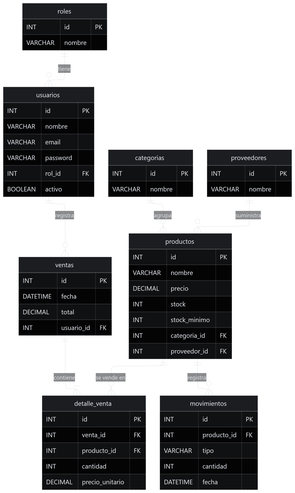

### 8.3. Frontend e Integración con la API

**Tecnologías.** React 19 con Vite 8, React Router 7 para la navegación, Tailwind CSS 4 para los estilos y Recharts para el gráfico de ventas. La fuente Atkinson Hyperlegible Next se carga con @fontsource.

**Estructura de carpetas.** El código está en frontend/src: pages/ contiene una vista por pantalla; components/ los elementos reutilizables (Layout con el menú lateral, ModalProducto, GraficoVentas, ProtectedRoute, recibo y MarcaLogo); services/ la comunicación con la API (auth.js guarda el token en localStorage y movimientosService.js consulta los movimientos). Las rutas se definen en App.jsx y la API se consume en http://localhost:3000.

**Estilos compartidos.** El archivo src/index.css define en @theme la paleta de la botica (botica, tinta, papel, línea, alerta y aviso) y en @layer components clases comunes que usan todas las pantallas: .btn con sus variantes (primario, secundario, peligro y chico), .campo y .etiqueta para formularios, .panel, .tabla, .mensaje-error, .mensaje-ok y .titulo-pagina. Así las vistas mantienen el mismo aspecto sin repetir estilos.

| **Pantalla** | **Ruta** | **Función** |
|----|----|----|
| **Login** | /login | Inicio de sesión con correo y contraseña. |
| **Dashboard** | /dashboard | Tarjetas de métricas y gráfico de ventas semanales (ruta protegida). |
| **Inventario** | /inventario | Listado de productos, alerta de stock crítico, modales para crear y editar. |
| **Historial de inventario** | /historial-inventario | Movimientos de stock con filtros. |
| **Punto de venta** | /pos | Buscador, carrito, cobro y recibo. |
| **Categorías** | /categorias | Gestión de categorías. |
| **Proveedores** | /proveedores | Gestión de proveedores. |
| **Alertas de stock** | /alertas | Productos con stock igual o menor al mínimo. |

**Dashboard con métricas y gráfico de ventas.**

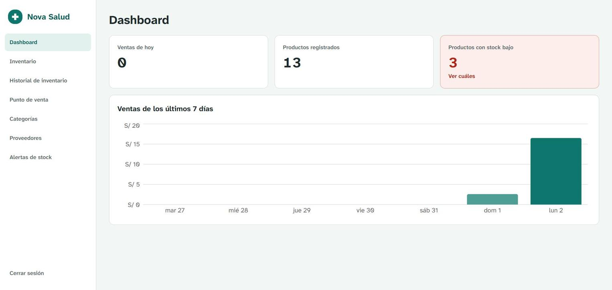

### 8.4. Gestión Colaborativa con Jira y GitHub

El trabajo se organizó en Jira con el sprint «PS2I Sprint 1», que reúne 83 tareas (PS2I-1 a PS2I-83). Al 3 de noviembre de 2026 hay 64 finalizadas, 4 en curso y 15 por hacer. En GitHub se trabajó con ramas feature/PS2I-XX creadas desde develop y fusionadas mediante pull requests hacia develop, usando la clave de Jira en el nombre de la rama y en el título del pull request.

| **Integrante** | **Usuario GitHub** | **Tareas Jira** | **Pull requests** | **Commits backend** | **Commits frontend** |
|----|----|----|----|----|----|
| **Pineda Morales, Cristhian Abraham** | edwardpm0310 | 24 | 22 | 18 | 6 |
| **Gil Toribio, Jeff Steven** | JeffStevenGT | 17 | 13 | 23 | 2 |
| **Martel Milla, James** | Jmartel-dev | 15 | 12 | 3 | 27 |
| **Najarro Mejia, Jhonatan Jhon** | john-najme | 14 | 14 | 7 | 1 |
| **Loayza Manchego, Cesar Rosendo** | Sh4dowlines | 13 | 10 | 7 | 5 |

Los commits se contaron sin incluir los merges; un commit se cuenta en backend o frontend si modifica archivos de esa carpeta. La trazabilidad entre tareas, ramas y pull requests se muestra con tareas representativas de cada integrante:

| **Tarea Jira** | **Responsable** | **Rama** | **PR** | **Estado** |
|----|----|----|----|----|
| **PS2I-1 Setup inicial** | Cristhian Pineda | feature/PS21-1 | \#2 | Fusionado |
| **PS2I-37 Registrar venta** | Cristhian Pineda | feature/PS2I-37 | \#30 | Fusionado |
| **PS2I-54 Gráfico de ventas** | Cristhian Pineda | feature/PS2I-54b | \#55 | Fusionado |
| **PS2I-13 verifyToken y /api/me** | Jeff Gil | feature/PS2I-13 | \#20 | Fusionado |
| **PS2I-50 Dashboard métricas** | Jeff Gil | feature/PS2I-50 | \#42 | Fusionado |
| **PS2I-61 Dockerfile backend** | Jeff Gil | feature/PS2I-61 | \#62 | Fusionado |
| **PS2I-62 Dockerfile frontend** | Jeff Gil | feature/PS2I-62 | \#68 | Fusionado |
| **PS2I-6 Inicializar frontend** | James Martel | feature/PS2I-6 | \#8 | Fusionado |
| **PS2I-41 Vista del POS** | James Martel | feature/PS2I-41 | \#48 | Fusionado |
| **PS2I-42 Cobrar desde el POS** | James Martel | feature/PS2I-42 | \#49 | Fusionado |
| **PS2I-4 Inicializar backend** | Jhonatan Najarro | feature/PS2I-4 | \#7 | Fusionado |
| **PS2I-32 Proveedores** | Jhonatan Najarro | feature/PS2I-32 | \#33 | Fusionado |
| **PS2I-71 Diagrama ER** | Jhonatan Najarro | feature/PS2I-71 | \#63 | Fusionado |
| **PS2I-76 Manual de usuario** | Jhonatan Najarro | feature/PS2I-76 | \#71 | Fusionado |
| **PS2I-11 Login con JWT** | Cesar Loayza | feature/PS2I-11 | \#9 | Fusionado |
| **PS2I-18 Ruta protegida** | Cesar Loayza | feature/PS2I-18 | \#13 | Fusionado |
| **PS2I-58 Historial inventario** | Cesar Loayza | feature/T58-historial-inventario | \#56 | Fusionado |
| **PS2I-70 Revisión de credenciales** | Cesar Loayza | feature/PS2I-70-revision-credenciales | \#69 | Abierto |

Las evidencias de ramas, pull requests y del sprint en Jira se presentan en la sección 6.3.

### 8.5. Pruebas y validación

**Qué se probó.** Se hicieron pruebas funcionales por endpoint con Postman, pruebas de interfaz recorriendo cada pantalla del sistema (login, dashboard, inventario, punto de venta y alertas) y pruebas de caja negra intentando forzar errores (T48).

**Con qué.** Se usaron las colecciones Postman del repositorio: postman/productos.postman_collection.json, con 11 casos sobre GET, POST, PUT y DELETE que esperan respuestas 200, 201, 400 y 404, y los casos de autenticación en backend/Nova-Salud Auth Tests (registro 201 y 400, login 200 y 401). Los reportes de caja negra y de rol vendedor están en documentacion/.

**Resultados.** Los casos válidos respondieron 200 OK, por ejemplo el listado de productos. Los inválidos fueron rechazados sin modificar datos: una venta que pide 110 unidades con 109 en stock devuelve 400 «Stock insuficiente de Paracetamol 500mg», y una venta sin productos devuelve 400 «usuario_id y productos son requeridos». Como la venta se procesa en una transacción, un rechazo no descuenta stock. La colección incluye borrar un producto con ventas, que el backend responde con 400 porque la clave foránea de detalle_venta impide el borrado. En caja negra, los 4 casos fueron funcionales (login vacío, cobro sin sesión, carrito vacío y URL inexistente), y en el recorrido de la interfaz la venta se registró y el stock bajó en una unidad.

**Limitaciones.** No se probó la carga con varios usuarios a la vez, el funcionamiento en navegadores distintos ni en dispositivos móviles reales. Las pruebas se ejecutaron en entorno local contra la base de datos de Aiven.

**Postman: GET /api/productos responde 200 OK.**

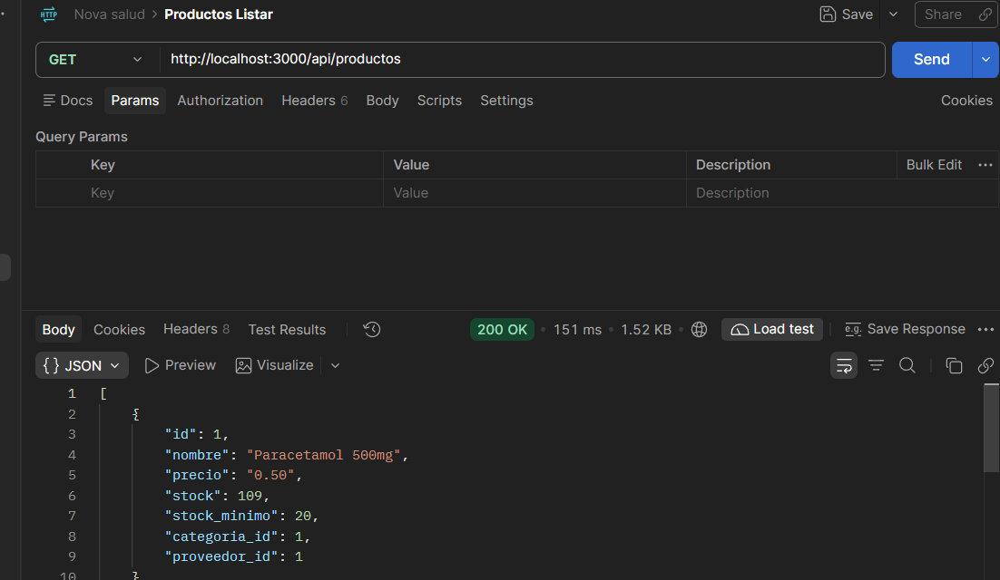

**Postman: venta con cantidad mayor al stock responde 400.**

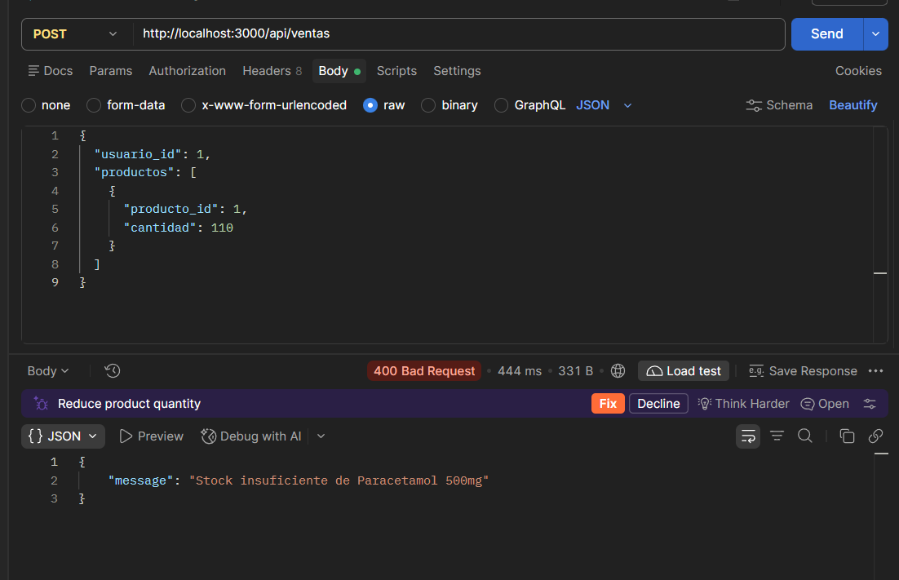

**Pantalla de alertas con los productos bajo el stock mínimo.**

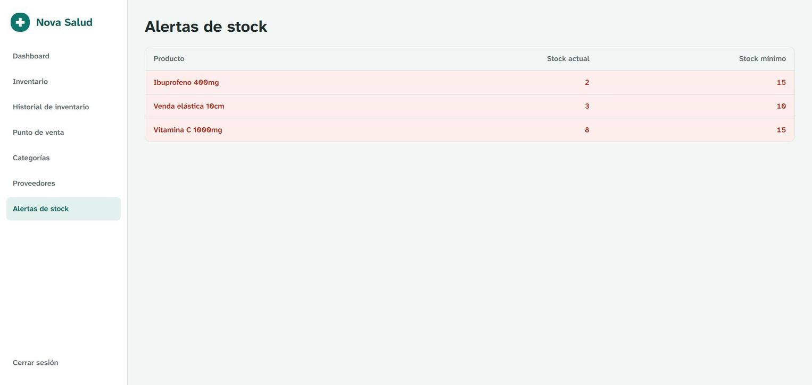

## 9. Conclusiones

- Se implementó un sistema web full stack que reemplaza el registro manual de ventas e inventario de la botica Nova Salud por un flujo digital: inicio de sesión, gestión de productos, categorías y proveedores, punto de venta, historial de movimientos, alertas y dashboard.

- La separación en frontend (React), backend (Node.js con Express) y base de datos (MySQL en Aiven) permitió que cada integrante trabajara en una capa con contratos claros, definidos en docs/contrato-api.md.

- El registro de ventas mediante una transacción garantiza que el stock, el detalle de la venta y el movimiento de salida se guarden juntos o no se guarden, lo que resuelve el principal problema del proceso manual: la diferencia entre el stock anotado y el real.

- El uso de Jira y GitHub permitió trazar cada cambio desde la tarea hasta el pull request: 83 tareas en el sprint y 71 pull requests, con ramas que incluyen la clave de la tarea.

- Las pruebas documentadas (autenticación, caja negra, control de acceso y flujo completo) muestran que las funciones principales del sistema operan correctamente y que los datos se mantienen consistentes ante operaciones inválidas.

## 10. Recomendaciones

Las siguientes recomendaciones están orientadas a la evolución del sistema en una siguiente versión del proyecto:

- **Facturación electrónica:** integrar la emisión de boletas y facturas electrónicas conforme a SUNAT, para que el recibo del punto de venta tenga validez tributaria.
- **Lotes y fechas de vencimiento:** registrar el lote y la fecha de vencimiento de cada producto y generar alertas de productos próximos a vencer, algo clave en una botica.
- **Lector de código de barras:** permitir buscar y agregar productos al carrito con un lector de código de barras para agilizar la atención en caja.
- **Reportes exportables:** generar reportes de ventas, inventario y movimientos por rango de fechas, con exportación a PDF y Excel.
- **Notificaciones:** enviar avisos por correo o mensajería al administrador cuando un producto llegue al stock mínimo.
- **Pruebas automatizadas e integración continua:** incorporar pruebas con Jest y Supertest y ejecutarlas con GitHub Actions en cada pull request.
- **Despliegue en la nube:** publicar el frontend y el backend en un servicio en la nube a partir de las imágenes Docker, para acceder al sistema desde cualquier equipo.
- **Diseño adaptable y varias sedes:** adaptar la interfaz a tablets y celulares y preparar el sistema para manejar el inventario de más de un local.

## 11. Referencias bibliográficas

Aiven. (2026). Aiven for MySQL documentation. https://aiven.io/docs/products/mysql

Atlassian. (2026). Jira Software documentation. https://support.atlassian.com/jira-software-cloud/

Express. (2026). Express 5.x API reference. https://expressjs.com/en/5x/api.html

GitHub. (2026). About pull requests. https://docs.github.com/en/pull-requests

Grupo 1 Nova Salud. (2026). Group-1-Nova-Salud \[Repositorio de código\]. GitHub. https://github.com/2026-II-Senati/Group-1-Nova-Salud

Jones, M., Bradley, J. y Sakimura, N. (2015). JSON Web Token (JWT) (RFC 7519). IETF. https://www.rfc-editor.org/rfc/rfc7519

Meta Open Source. (2026). React documentation. https://react.dev/

Oracle. (2026). MySQL 8.4 Reference Manual. https://dev.mysql.com/doc/refman/8.4/en/

OpenJS Foundation. (2026). Node.js documentation. https://nodejs.org/docs/latest/api/

Tailwind Labs. (2026). Tailwind CSS documentation. https://tailwindcss.com/docs

Vite. (2026). Vite guide. https://vite.dev/guide/
