# Manual de Usuario — Sistema Nova Salud

Elaborado por: Jhonatan Najarro Mejia\
Equipo: Grupo 1 — Nova Salud (curso PIAD-527)

## 1. ¿Para qué sirve este manual?

Este manual explica, paso a paso y con imágenes, cómo usar el sistema de inventario y ventas de la botica Nova Salud. No necesita conocimientos técnicos: solo seguir los pasos en el orden indicado.

Aprenderá a:

1. Iniciar sesión.
2. Registrar un producto nuevo.
3. Realizar una venta.
4. Ver las alertas de productos con poco stock.

**Antes de empezar:** abra el navegador (Chrome, Edge o similar) y entre a la dirección del sistema que le indique el encargado. Necesita un correo y una contraseña asignados por el administrador.

## 2. Iniciar sesión

**Paso 1.** Al abrir el sistema verá la pantalla "Iniciar sesión".

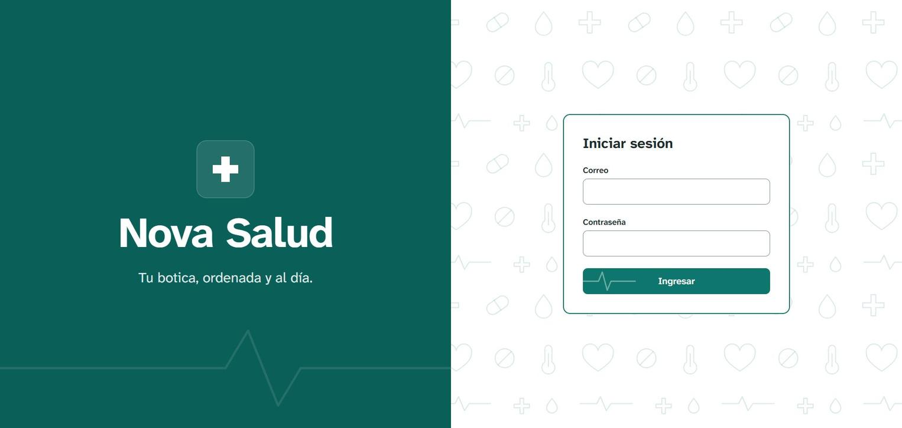

**Paso 2.** En "Correo" escriba su correo. En "Contraseña" escriba su contraseña. Por seguridad, la contraseña se muestra con puntos.

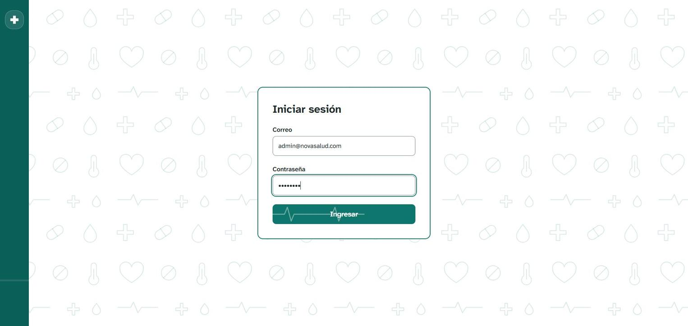

**Paso 3.** Presione el botón verde **Ingresar**.

**Paso 4.** Si los datos son correctos, verá la pantalla principal (Dashboard). Si aparece un mensaje de error, revise que el correo y la contraseña estén bien escritos e inténtelo otra vez.

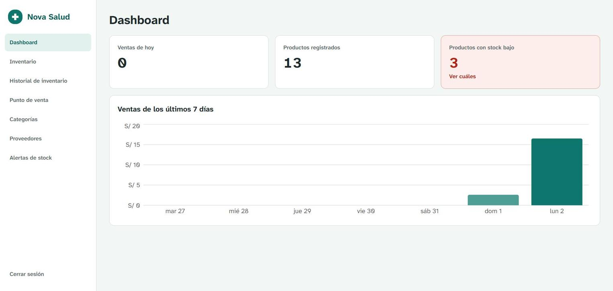

En la pantalla principal puede ver de un vistazo:

- **Ventas de hoy:** cuántas ventas se hicieron en el día.
- **Productos registrados:** cuántos productos hay en el sistema.
- **Productos con stock bajo:** cuántos productos se están acabando. Con "Ver cuáles" se abre la lista.
- **Ventas de los últimos 7 días:** un gráfico con lo vendido cada día.

A la izquierda está el **menú**. Desde ahí se entra a cada sección: Inventario, Punto de venta, Alertas de stock, etc. Para salir, presione **Cerrar sesión** (abajo a la izquierda).

## 3. Registrar un producto nuevo

**Paso 1.** En el menú de la izquierda presione **Inventario**. Verá la lista de todos los productos con su categoría, precio y stock (cantidad disponible). Los productos que se están acabando aparecen en rojo con la etiqueta "Stock bajo".

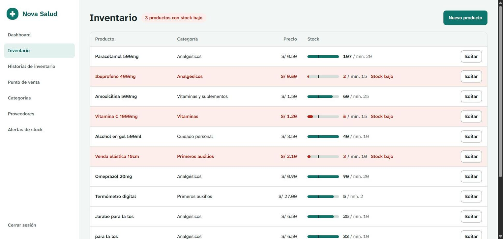

**Paso 2.** Presione el botón verde **Nuevo producto** (arriba a la derecha). Se abrirá un formulario.

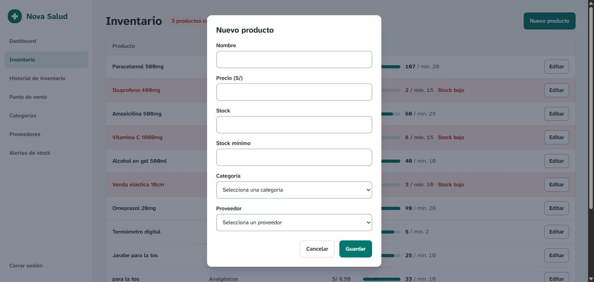

**Paso 3.** Complete los datos del formulario:

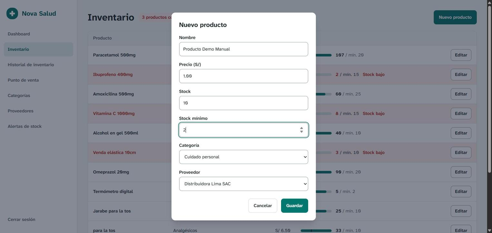

Qué escribir en cada campo:

| Campo | Qué escribir | Ejemplo |
|---|---|---|
| Nombre | Nombre del producto como se vende | Producto Demo Manual |
| Precio (S/) | Precio de venta por unidad, en soles | 1.00 |
| Stock | Cantidad de unidades que hay ahora | 10 |
| Stock mínimo | Cantidad a partir de la cual el sistema avisará que se está acabando | 2 |
| Categoría | Elija de la lista | Cuidado personal |
| Proveedor | Elija de la lista quién lo provee | Distribuidora Lima SAC |

**Paso 4.** Presione **Guardar**. Si se equivocó y no desea registrarlo, presione **Cancelar**.

**Paso 5.** El producto aparecerá en la lista de inventario.

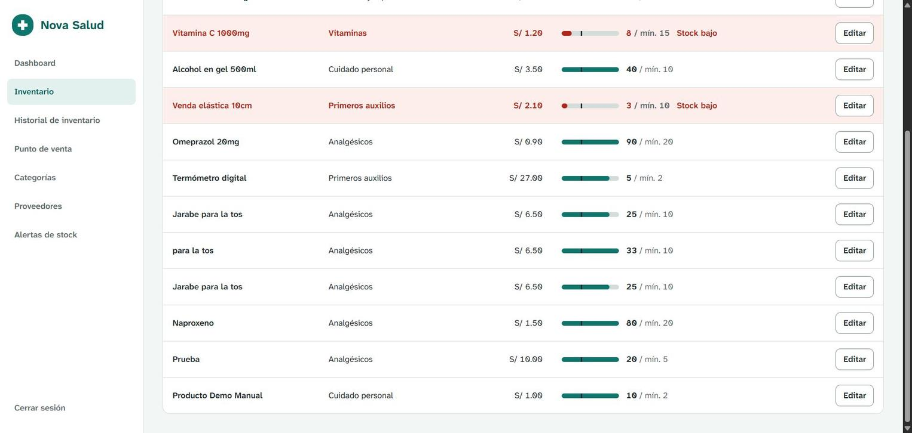

Para cambiar los datos de un producto ya registrado, presione **Editar** en la fila del producto, corrija los datos y guarde.

## 4. Realizar una venta

**Paso 1.** En el menú presione **Punto de venta**. A la izquierda verá los productos disponibles y a la derecha el **Carrito** (lo que el cliente va a llevar).

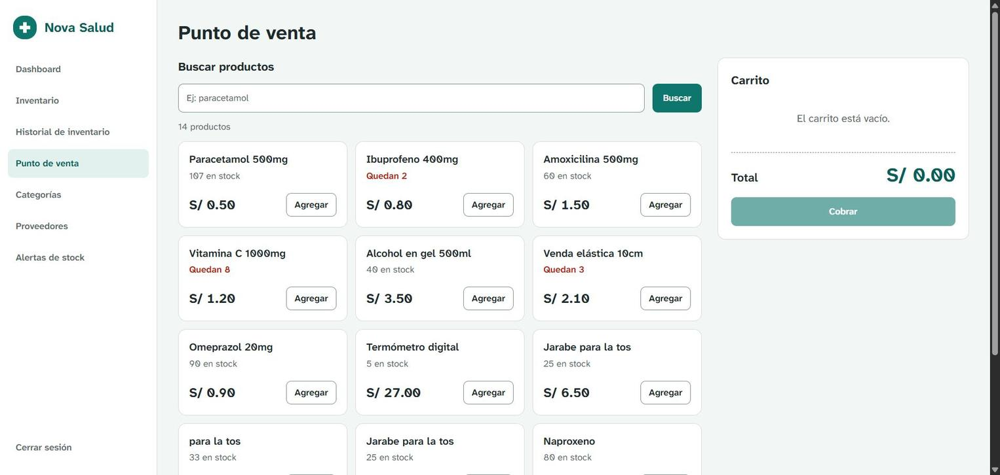

**Paso 2.** Para encontrar un producto rápido, escriba parte de su nombre en "Buscar productos" y presione **Buscar**. Para volver a ver todos, presione **Ver todos**.

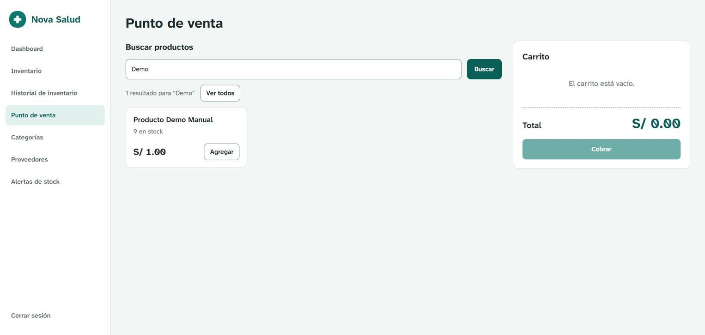

**Paso 3.** Presione **Agregar** en el producto que pide el cliente. El producto pasa al carrito.

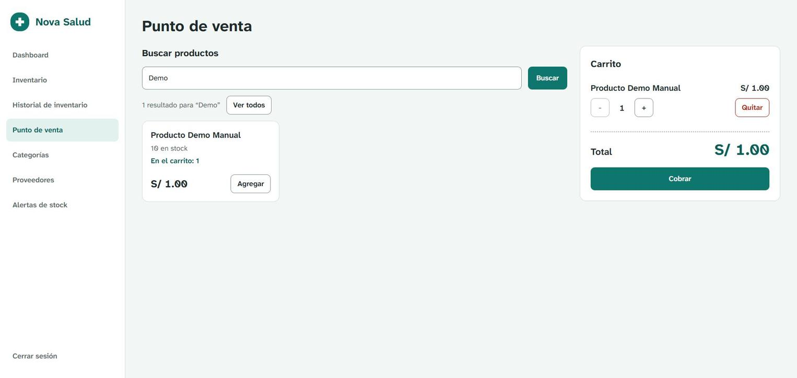

En el carrito:

- Con los botones **+** y **−** aumenta o disminuye la cantidad.
- Con **Quitar** saca el producto del carrito.
- El **Total** se calcula solo.

**Paso 4.** Revise que los productos y el total sean correctos y presione **Cobrar**.

**Paso 5.** El sistema mostrará un mensaje como "Venta #11 registrada. Total: S/ 1.00". El carrito queda vacío para la siguiente venta y el stock del producto baja automáticamente (en el ejemplo, de 10 a 9).

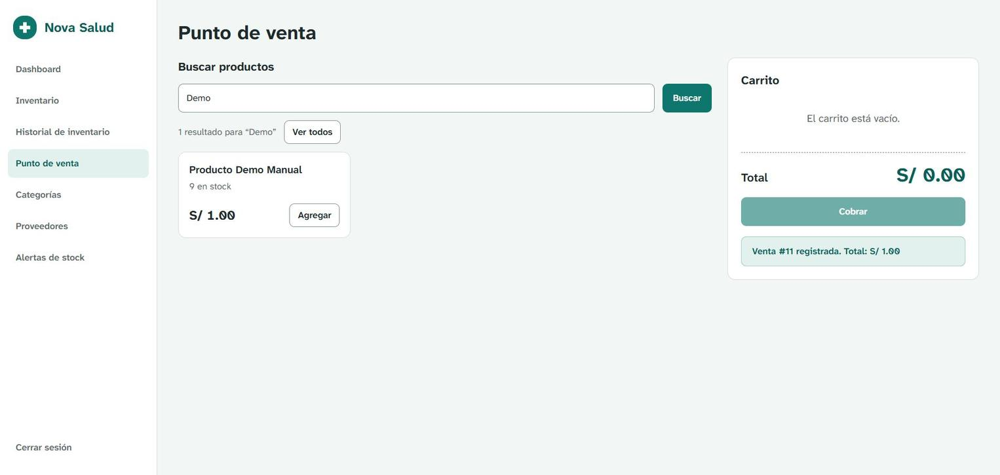

Nota: el botón **Cobrar** solo se activa cuando hay al menos un producto en el carrito.

## 5. Ver las alertas de stock

**Paso 1.** En el menú presione **Alertas de stock**. También puede llegar desde la pantalla principal con "Ver cuáles". Verá la lista de productos cuyo stock actual es igual o menor que su stock mínimo, es decir, los que se están acabando y conviene volver a pedir al proveedor.

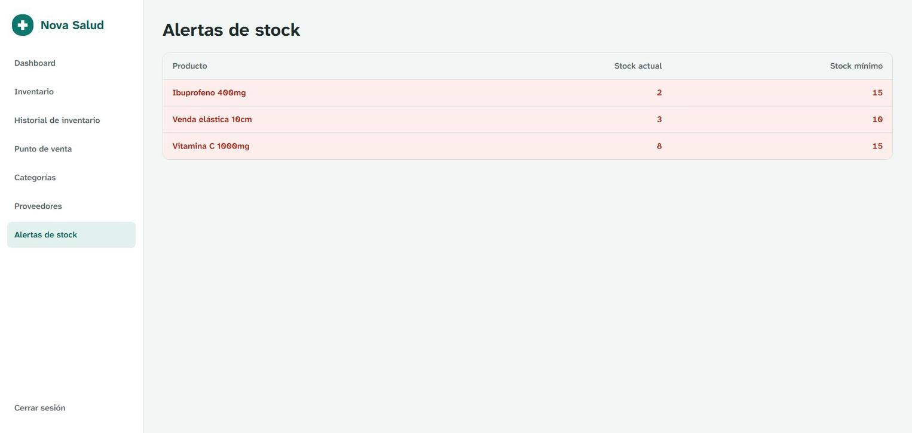

Cómo leer la tabla:

- **Producto:** nombre del producto.
- **Stock actual:** unidades que quedan.
- **Stock mínimo:** cantidad límite definida al registrar el producto.

Ejemplo: "Ibuprofeno 400mg — 2 — 15" significa que quedan 2 unidades y lo recomendable es tener al menos 15. Cuando se repone el producto y su stock supera el mínimo, deja de aparecer en esta lista.

## 6. Problemas frecuentes

| Problema | Qué hacer |
|---|---|
| No puedo ingresar | Revise correo y contraseña (mayúsculas y espacios). Si persiste, pida ayuda al administrador. |
| La página no carga | Revise su conexión a internet y vuelva a cargar la página. Si sigue igual, avise al encargado del sistema. |
| El botón Cobrar está apagado | Agregue al menos un producto al carrito. |
| No encuentro un producto en la venta | Presione "Ver todos" o escriba solo una parte del nombre. Si no existe, regístrelo en Inventario. |
| Me equivoqué al registrar un producto | En Inventario, presione "Editar" en ese producto y corrija. |
