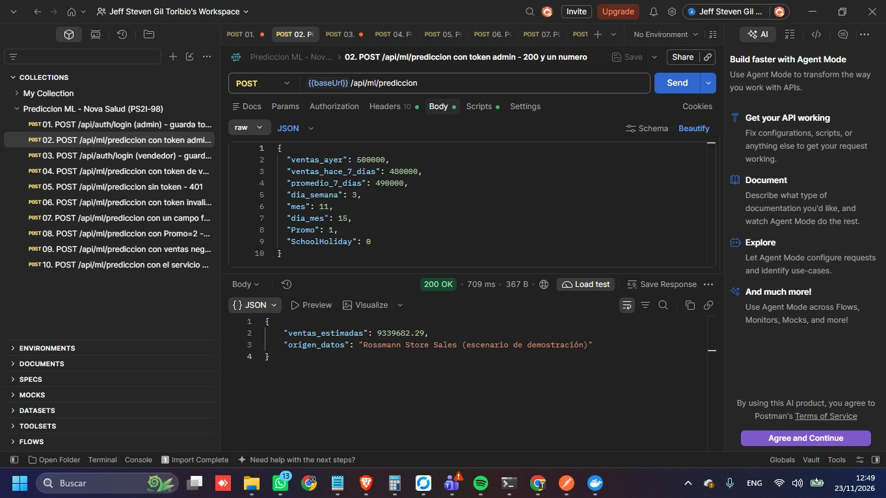
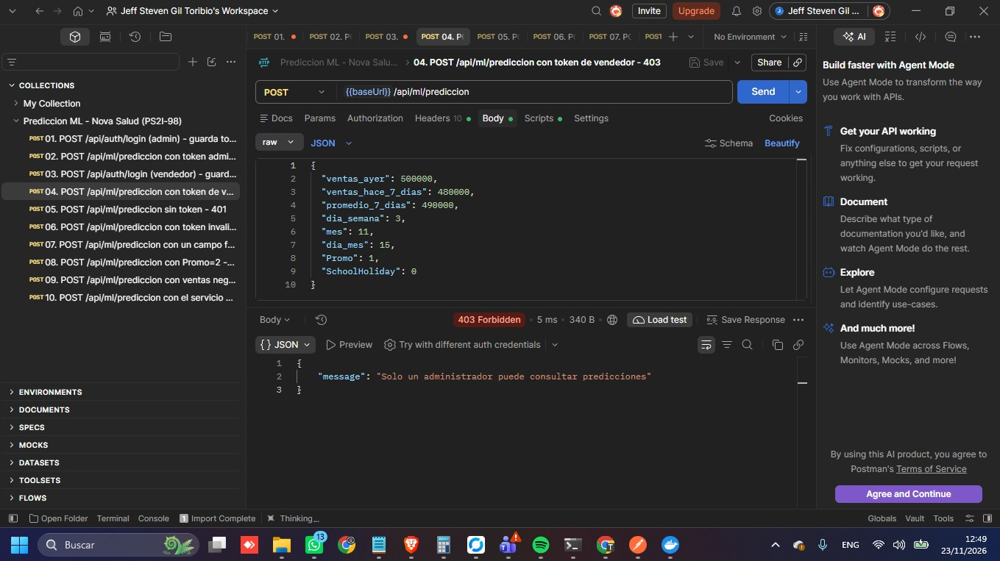
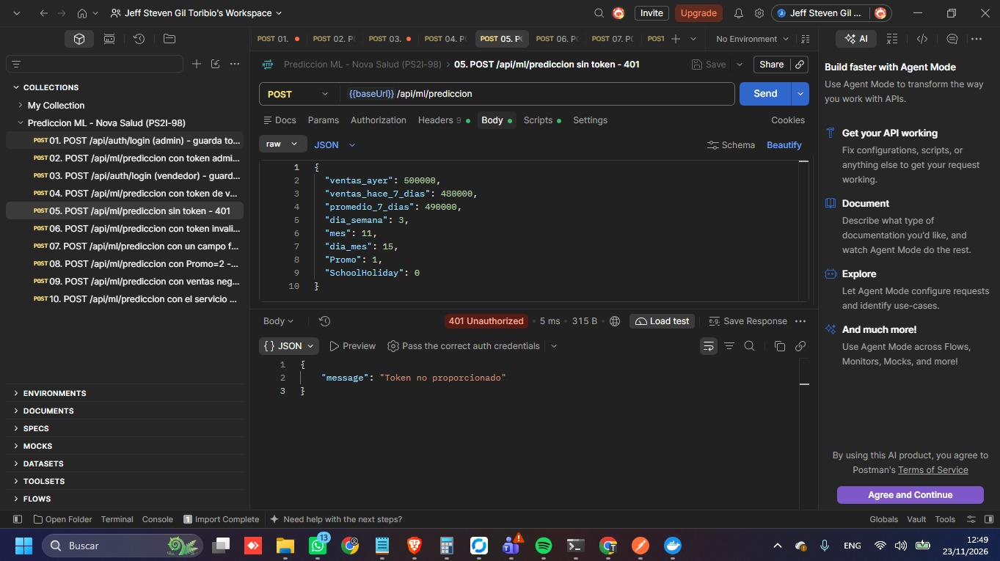
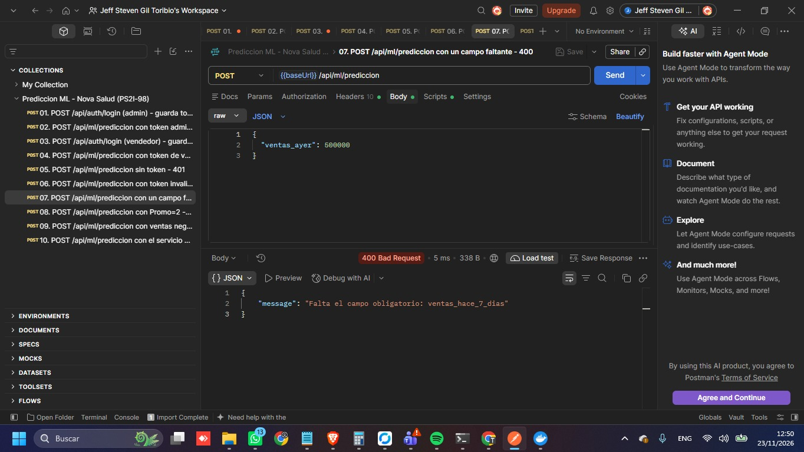
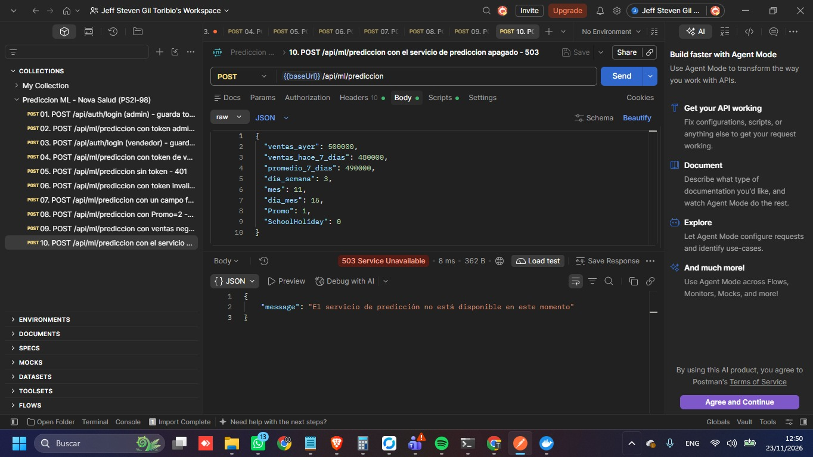

# Informe final — Módulo de Pronóstico Diario de Ventas con Machine Learning

**Ampliación del Sistema Web Nova Salud con un modelo de regresión para estimar las ventas del día siguiente**

- **Institución:** SENATI
- **Carrera:** Ingeniería de Software con IA
- **Curso:** Taller de Desarrollo de Aplicaciones con Machine Learning
- **Ciclo:** V semestre — Perú, 2026
- **Integrantes (Grupo 1):** Gil Toribio, Jeff Steven; Loayza Manchego, Cesar Rosendo; Martel Milla, James; Najarro Mejia, Jhonatan Jhon; Pineda Morales, Cristhian Abraham
- **Repositorio:** https://github.com/2026-II-Senati/Group-1-Nova-Salud

## Índice

- [Introducción](#introducción)
- [1. Generalidades de la empresa](#1-generalidades-de-la-empresa)
- [2. Realidad problemática](#2-realidad-problemática)
- [3. Objetivos](#3-objetivos)
- [4. Justificaciones](#4-justificaciones)
- [5. Conceptos fundamentales](#5-conceptos-fundamentales)
- [6. Tecnologías involucradas](#6-tecnologías-involucradas)
- [7. Propuesta del caso](#7-propuesta-del-caso)
- [8. Implementación del módulo de Machine Learning](#8-implementación-del-módulo-de-machine-learning)
  - [8.1. Arquitectura de la solución](#81-arquitectura-de-la-solución)
  - [8.2. Preparación de los datos](#82-preparación-de-los-datos)
  - [8.3. Entrenamiento y comparación de algoritmos](#83-entrenamiento-y-comparación-de-algoritmos)
  - [8.4. Endpoint POST /api/ml/prediccion](#84-endpoint-post-apimlprediccion)
  - [8.5. Pantalla de Predicciones](#85-pantalla-de-predicciones)
  - [8.6. Despliegue con Docker](#86-despliegue-con-docker)
  - [8.7. Gestión colaborativa con Jira y GitHub](#87-gestión-colaborativa-con-jira-y-github)
  - [8.8. Pruebas y validación](#88-pruebas-y-validación)
- [9. Conclusiones](#9-conclusiones)
- [10. Recomendaciones](#10-recomendaciones)
- [11. Referencias bibliográficas](#11-referencias-bibliográficas)

# Introducción

La gestión de ventas requiere registrar operaciones y disponer de información que permita examinar su comportamiento. El sistema web Nova Salud centraliza productos, existencias y ventas, y ofrece consultas e indicadores. Sobre esta base, el proyecto incorpora un módulo de pronóstico diario de ventas mediante aprendizaje automático.

La solución estimará el importe agregado del día siguiente a partir de ventas históricas y variables de calendario. Su desarrollo utilizará Rossmann Store Sales como fuente externa de datos. El resultado se presentará dentro de Nova Salud en un entorno de demostración identificado, sin atribuir el comportamiento de las tiendas de origen a la operación real de la botica.

El proceso comprenderá preparación del historial, comparación de regresión lineal y bosque aleatorio, validación temporal, prueba final y exportación. La integración utilizará React, el backend de Node.js con Express y un servicio de inferencia en Python con FastAPI. El entrenamiento será independiente de las consultas.

Este avance presenta las generalidades de la empresa, la realidad problemática, los objetivos, las justificaciones, los fundamentos conceptuales y las tecnologías del módulo. La evaluación se basará en información disponible antes del día objetivo y conservará un periodo final separado de la selección del algoritmo.

# 1. Generalidades de la empresa

## 1.1. Denominación y ubicación

Para el caso práctico, la organización se denomina Botica Nova Salud y se dedica a la comercialización minorista de medicamentos y productos farmacéuticos en una zona comercial de alta demanda. El caso no proporciona razón social legal, RUC ni dirección, por lo que estos datos no se presentan como información real. Su actividad vincula la atención al cliente con la recepción de productos, el control de existencias y el registro de ventas. El proyecto se desarrolla sobre el sistema web Nova Salud, destinado a organizar la información de estas operaciones.

El ámbito de intervención comprende el sistema de información de ventas. La ampliación añadirá una consulta predictiva y permitirá demostrar el funcionamiento de un modelo de regresión dentro de la plataforma.

## 1.2. Giro del negocio

Nova Salud pertenece al sector farmacéutico minorista. Su operación comprende la recepción y organización de productos, la consulta de disponibilidad, la venta y el seguimiento de cantidades. La coordinación de estas actividades permite relacionar los ingresos de mercadería con las salidas registradas en el punto de venta.

La gestión del establecimiento requiere información organizada sobre productos, precios, proveedores y existencias. El sistema web centraliza esos datos y facilita su consulta por parte del personal autorizado. Sobre esta base se incorporará el componente de aprendizaje automático.

## 1.3. Productos comercializados

El catálogo inicial del sistema contiene paracetamol 500 mg, ibuprofeno 400 mg, amoxicilina 500 mg, vitamina C 1000 mg, alcohol en gel 500 ml, venda elástica de 10 cm, omeprazol 20 mg y termómetro digital. Cada producto dispone de código, nombre, precio, stock, stock mínimo, categoría y proveedor.

El catálogo permite identificar artículos, relacionarlos con los detalles de venta y consultar sus existencias. Se conservará como parte de la aplicación operativa. El modelo de esta etapa no estimará cantidades por medicamento: su salida será un importe diario agregado procedente del conjunto de datos externo.

## 1.4. Mercado objetivo

La botica orienta su actividad a personas que requieren medicamentos y productos farmacéuticos. La disponibilidad de los artículos y la agilidad de consulta son aspectos vinculados al servicio del establecimiento.

El proyecto se concentra en la gestión de información comercial. No utilizará datos clínicos ni identidades de compradores. La tabla de modelado representará fechas y ventas agregadas de las tiendas incluidas en Rossmann.

## 1.5. Procesos de inventario y ventas

El proceso de inventario comprende la identificación de productos, el registro de cantidades y la consulta de existencias. El catálogo relaciona cada artículo con una categoría y un proveedor, e incorpora un stock mínimo utilizado para señalar los productos que requieren revisión.

La venta se registra mediante una cabecera y un detalle. La cabecera reúne fecha, usuario e importe total; el detalle identifica productos, cantidades y precios unitarios. El sistema actualiza las existencias y registra los movimientos de salida. Los historiales permiten consultar las operaciones realizadas.

El módulo predictivo se incorporará como una función de análisis separada del registro de ventas. El usuario consultará un día objetivo y visualizará el importe estimado, junto con la fecha de corte y la identificación del escenario de datos utilizado.

## 1.6. Usuarios y responsabilidades

El sistema contempla los perfiles de administrador y vendedor. El administrador gestiona productos, categorías, proveedores y usuarios, mientras el vendedor registra ventas y consulta existencias y alertas.

La consulta se orientará al usuario autorizado para revisar información comercial. Su responsabilidad será interpretar el alcance del resultado. El módulo no sustituirá decisiones de compra ni el criterio del personal farmacéutico.

## 1.7. Sistema de información y área de intervención

La plataforma utiliza React para la interfaz, Node.js con Express para la lógica de negocio y una base de datos compatible con MySQL, alojada en TiDB Cloud, para almacenar información. Dispone de módulos de productos, inventario, ventas, movimientos, alertas y un panel de indicadores.

El área de intervención será el análisis de ventas. El módulo presentará el pronóstico del día siguiente al cierre disponible y mantendrá separadas las consultas predictivas de las transacciones que modifican el inventario.

## 1.8. Misión y visión del proyecto

La misión del proyecto es ampliar Nova Salud con un módulo de pronóstico diario de ventas que integre preparación de datos, evaluación temporal y consulta web mediante un procedimiento reproducible.

La visión es establecer una base tecnológica para incorporar análisis predictivo al sistema, con capacidad de evaluar posteriormente modelos entrenados con información propia y suficiente de la botica.

# 2. Realidad problemática

## 2.1. Situación actual

El sistema Nova Salud permite registrar ventas y controlar existencias de forma centralizada. El personal consulta productos, revisa operaciones y reconoce los artículos que alcanzan el stock mínimo. Estas funciones proporcionan información sobre el estado del inventario y las transacciones realizadas.

Sin embargo, la plataforma no incorpora un pronóstico del importe de ventas del día siguiente. La información de operaciones realizadas no se complementa todavía con una consulta predictiva integrada al entorno de gestión.

La nueva función se distinguirá del control de stock: el umbral mínimo expresa una condición del inventario, mientras el pronóstico estima un importe futuro. El módulo no calculará unidades de reposición ni demanda por producto.

## 2.2. Problema central

La ausencia de un módulo de pronóstico impide consultar estimaciones de ventas futuras desde la plataforma. El proyecto aborda esta brecha mediante la integración de un modelo de regresión y una interfaz que comunique el periodo, la unidad y el alcance de cada resultado.

El desarrollo utilizará una fuente externa para construir y evaluar el componente. La necesidad de la aplicación se resolverá en términos de integración funcional; su utilidad sobre ventas reales de Nova Salud requerirá una evaluación posterior con información propia.

## 2.3. Formulación del problema

¿Cómo desarrollar e integrar al sistema web Nova Salud un módulo que pronostique el importe agregado de ventas del día siguiente, utilizando datos de Rossmann y una evaluación temporal libre de información del periodo objetivo?

## 2.4. Disponibilidad y procedencia de los datos

Se utilizará Rossmann Store Sales, publicado en Kaggle para el pronóstico de ventas de 1 115 tiendas. La fuente contiene observaciones por tienda y fecha, ventas, clientes, apertura, promociones e indicadores de festivos. El historial de entrenamiento comprende desde enero de 2013 hasta julio de 2015.

El procesamiento parte del archivo de ventas de origen, identificado en el directorio ml/data/raw/ como rossmann.csv. El archivo de origen y la tabla diaria preparada se conservan como productos distintos: el primero mantiene registros por tienda y día; la segunda representa la suma de ventas por fecha. El archivo de origen contiene 1 001 599 registros por tienda y fecha, entre el 1 de enero de 2013 y el 17 de julio de 2015. La limpieza descartó 170 627 registros de tiendas cerradas y 54 registros de tiendas abiertas sin ventas, por lo que se conservaron 830 918. La agregación diaria produjo 928 fechas consecutivas, sin días ausentes en el calendario. Se eliminaron los primeros siete días porque no tienen historial suficiente para calcular los rezagos; así, la tabla de modelado final cuenta con 921 días, del 8 de enero de 2013 al 17 de julio de 2015. Los datos reales del conjunto Rossmann no se presentarán como registros de Nova Salud.

## 2.5. Alcance y limitaciones

El horizonte será un día calendario. Para cada fecha objetivo se utilizarán ventas del día anterior, ventas de siete días antes, un promedio de los siete días previos y variables de calendario. El número de clientes no forma parte de las entradas. Los indicadores adicionales solo se utilizarán si su valor es conocido antes del pronóstico; cuando sean supuestos de un escenario, se identificarán como tales.

La evaluación representará consultas de un paso adelante con actualización del historial al cierre de cada día. Se separarán entrenamiento, validación y prueba por fechas. El resultado corresponderá a ventas agregadas de las tiendas incluidas, no a un producto ni a una tienda individual. La serie externa no valida pronósticos para Nova Salud; tampoco permite determinar compras, demanda no atendida o beneficios económicos reales. La escala monetaria del archivo se conservará y no se etiquetará como soles sin una conversión explícita y documentada. Además, entre julio y diciembre de 2014 el número promedio de tiendas con registros, de lunes a sábado, baja de alrededor de 1 070 a unas 910 por día. Por ello, la suma diaria de ese periodo puede descender sin que haya disminuido la demanda, y esta variación se tomará en cuenta al interpretar los resultados.

# 3. Objetivos

## 3.1. Objetivo general

Desarrollar e integrar al sistema web Nova Salud un módulo de aprendizaje automático que pronostique el importe agregado de ventas del día siguiente a partir de datos Rossmann, mediante variables disponibles antes de la fecha objetivo y una evaluación temporal independiente.

## 3.2. Objetivos específicos

1\. Explorar Rossmann Store Sales e identificar los campos, el periodo y los criterios de calidad necesarios para construir la serie diaria agregada.

2\. Preparar y documentar el archivo de origen y la tabla de modelado, verificando fechas, conteos, valores faltantes y continuidad del calendario.

3\. Construir variables históricas y de calendario sin incorporar clientes reales ni ventas del día objetivo como entradas del pronóstico.

4\. Comparar regresión lineal y bosque aleatorio frente a un método de referencia, utilizando el mismo periodo de validación y MAE como criterio principal.

5\. Evaluar el modelo seleccionado en un tramo temporal final reservado y reportar MAE, RMSE y R² junto con el periodo de evaluación.

6\. Exportar el estimador seleccionado y la definición de sus entradas, e integrarlo mediante Express y un servicio FastAPI que ejecute la inferencia en Python.

7\. Verificar la consistencia entre la inferencia directa y la API, el manejo de solicitudes inválidas y la presentación del resultado en la web de Nova Salud.

# 4. Justificaciones

## 4.1. Justificación tecnológica

La propuesta ampliará una aplicación existente mediante análisis predictivo. La reutilización de interfaz, backend y base de datos permitirá concentrar el desarrollo en preparación de información, entrenamiento e inferencia.

La integración conectará el aprendizaje automático con una necesidad funcional. El usuario consultará estimaciones desde Nova Salud, mientras el procesamiento mantendrá las mismas variables y transformaciones utilizadas en el entrenamiento.

## 4.2. Justificación económica

El pronóstico puede aportar una referencia para analizar el comportamiento esperado de ventas. En esta etapa, el aporte consiste en desarrollar la capacidad de consulta e integración; los efectos económicos de utilizar un modelo en Nova Salud deberán medirse posteriormente con registros propios.

real frente a la estimada en el tramo de prueba](img/ml-real-vs-estimado.png)

La Figura 8 muestra que el modelo sigue la forma semanal de la serie, incluidas las caídas de los domingos. Los mayores errores aparecen en los feriados nacionales del periodo, como el 3 y el 6 de abril, el 1, el 14 y el 25 de mayo y el 4 de junio de 2015: esos días casi todas las tiendas cerraron y la venta real cayó a menos de 0,3 millones, mientras que el modelo esperaba un día normal. También falla el día previo a un feriado, como el 1 de abril, cuando las ventas se adelantan. El modelo no tiene una variable de feriados nacionales (StateHoliday), por lo que no puede anticiparlos.

**Figura 9. Importancia de las variables del modelo final.**


El día de la semana concentra el 62,7 % de la importancia, seguido de la promoción (13,6 %) y de las ventas del día anterior (9,2 %). El feriado escolar casi no aporta (0,3 %), porque en la tabla agregada vale 1 si al menos una tienda lo registró, lo que ocurre en la mitad de los días.

**Cambio respecto a la versión anterior.** Una versión previa de train.py ajustaba GridSearchCV con el tramo de validación y sin TimeSeriesSplit, y elegía el modelo comparando en la prueba. Con ese procedimiento se reportó un R² de 0,8226 con 200 árboles y profundidad máxima de 10. Al corregir el procedimiento para que coincida con lo descrito en la sección 5.7, el R² en prueba subió a 0,8256 y el MAE bajó de 738 848,52 a 695 674,66. Los valores de este informe corresponden al train.py y al modelo.pkl actuales de la rama develop.

## 8.4. Endpoint POST /api/ml/prediccion

**Qué recibe.** Una petición POST con la cabecera Authorization: Bearer &lt;token&gt; y un cuerpo JSON con las ocho variables del modelo:

| **Campo** | **Tipo** | **Regla de validación** |
|----|----|----|
| **ventas_ayer** | número | Obligatorio, no negativo |
| **ventas_hace_7_dias** | número | Obligatorio, no negativo |
| **promedio_7_dias** | número | Obligatorio, no negativo |
| **dia_semana** | número | Obligatorio, entre 0 (lunes) y 6 (domingo) |
| **mes** | número | Obligatorio, entre 1 y 12 |
| **dia_mes** | número | Obligatorio, entre 1 y 31 |
| **Promo** | 0 o 1 | Obligatorio, solo acepta 0 o 1 |
| **SchoolHoliday** | 0 o 1 | Obligatorio, solo acepta 0 o 1 |

Ejemplo de petición:

```json
{
  "ventas_ayer": 500000,
  "ventas_hace_7_dias": 480000,
  "promedio_7_dias": 490000,
  "dia_semana": 3,
  "mes": 11,
  "dia_mes": 15,
  "Promo": 1,
  "SchoolHoliday": 0
}
```

**Qué devuelve.** Si todo es correcto, responde 200 con el importe estimado y el origen de los datos, para dejar claro que se trata de un escenario de demostración:

```json
{
  "ventas_estimadas": 9298368.26,
  "origen_datos": "Rossmann Store Sales (escenario de demostración)"
}
```

Cuando algo falla, todas las respuestas tienen el formato { "message": "..." } con el código HTTP correspondiente:

| **Código** | **Cuándo ocurre** | **Mensaje** |
|----|----|----|
| **401** | No se envía token | Token no proporcionado |
| **401** | El token es inválido o ya venció | Token inválido o vencido |
| **403** | El usuario no es administrador | Solo un administrador puede consultar predicciones |
| **400** | Falta un campo, tiene un tipo incorrecto o un valor fuera de rango | Por ejemplo, «Falta el campo obligatorio: ventas_hace_7_dias» o «El campo Promo debe valer 0 o 1» |
| **503** | El microservicio está apagado o no responde en 8 segundos | El servicio de predicción no está disponible en este momento |
| **502** | El microservicio responde, pero sin un importe válido | El servicio de predicción devolvió una respuesta inválida |

**Cómo se protege con el token y el rol de administrador.** La protección se aplica en dos pasos antes de que los datos lleguen al modelo. Primero, la ruta pasa por el middleware verifyToken, que exige la cabecera Authorization. El token es un JWT que el usuario obtiene en POST /api/auth/login; está firmado con la clave JWT_SECRET del servidor, contiene el identificador, el correo (email) y el rol_id del usuario, y vence a las 8 horas. El middleware comprueba la firma y la vigencia: si falta la cabecera responde 401 «Token no proporcionado», y si la firma no coincide o el token venció responde 401 «Token inválido o vencido». Si el token es válido, guarda los datos del usuario en la petición y la deja continuar.

Después, el controlador revisa el rol. Solo el administrador, con rol_id igual a 1, puede consultar predicciones; cualquier otro usuario, como el vendedor con rol_id igual a 2, recibe 403. Esta revisión ocurre antes de validar los datos, de modo que un usuario sin permiso no llega a enviar información al modelo. Solo cuando el usuario está autenticado, es administrador y los ocho campos son válidos, Express reenvía los datos al microservicio y devuelve la predicción.

## 8.5. Pantalla de Predicciones

La pantalla /predicciones solo aparece en el menú lateral del administrador, y la ruta está protegida en el frontend por el componente RutaAdmin. Parte de las ventas reales de los últimos 14 días del dataset (del 4 al 17 de julio de 2015) y permite marcar dos supuestos del escenario: si habrá promoción y si será feriado escolar. Con el botón Día siguiente se estima el 18 de julio de 2015; con Próxima semana se estiman siete días seguidos, usando cada estimación como el «ayer» del día siguiente, por lo que la pantalla advierte que el error puede acumularse. El resultado muestra el total y el promedio diario, los días objetivo, la fecha de corte del historial y el origen de los datos, y el gráfico une el histórico con la estimación punteada.

**Figura 10. Pantalla de Predicciones con la estimación de la próxima semana.**


La captura se tomó el 25 de noviembre de 2026 con el frontend, el backend y el microservicio de la rama develop ejecutándose en local. Sin promoción ni feriado escolar, el modelo estima 36 115 526,24 para la semana del 18 al 24 de julio de 2015 y reproduce la caída del domingo 19.

## 8.6. Despliegue con Docker

El servicio de ML tiene su propio Dockerfile en ml/, basado en python:3.11-slim. Instala las dependencias fijadas en ml/requirements.txt (entre ellas scikit-learn 1.8.0, la misma versión con la que se guardó el modelo), copia api.py y modelo.pkl y arranca uvicorn en el puerto 8000. El archivo docker-compose.yml levanta los tres servicios: backend (puerto 3000), frontend (puerto 5173) y ml (puerto 8000). El entrenamiento no forma parte de la imagen: cuando se reentrena el modelo hay que reconstruir el contenedor para que tome el nuevo modelo.pkl.

## 8.7. Gestión colaborativa con Jira y GitHub

El módulo se organizó en Jira en el «PS2I Sprint 2», con cinco épicas: 1. Datos, 2. Modelo, 3. Backend, 4. Frontend y 5. QA + Informe. Cada historia se trabajó en una rama feature/PS2I-XX creada desde develop, con la clave de Jira en el nombre de la rama, en los commits y en el pull request.

| **Épica** | **Tareas** | **Responsable** |
|----|----|----|
| **1. Datos** | PS2I-90 Descargar y explorar el dataset; PS2I-92 Verificar CSV y escribir README | James Martel |
| **1. Datos** | PS2I-91 Escribir limpiar_dataset.py y generar CSV | Cristhian Pineda |
| **2. Modelo** | PS2I-93 Escribir train.py y entrenar 2 algoritmos; PS2I-94 Comparar métricas y exportar modelo.pkl | Cristhian Pineda |
| **2. Modelo** | PS2I-95 Documentar justificación del algoritmo | Jhonatan Najarro |
| **3. Backend** | PS2I-96 Cargar modelo.pkl en el backend; PS2I-97 Crear endpoint POST /api/ml/prediccion; PS2I-98 Probar en Postman y ajustar | Jeff Gil |
| **4. Frontend** | PS2I-99 Maqueta de Predicciones.jsx; PS2I-100 Conectar al endpoint real; PS2I-101 Entrada en Layout.jsx (solo admin) | James Martel |
| **5. QA + Informe** | PS2I-102 Checklist de pruebas; PS2I-103 Ejecutar pruebas y reportar bugs; PS2I-104 Re-probar bugs; PS2I-108 Diagramas | Cesar Loayza |
| **5. QA + Informe** | PS2I-105 Documentar dataset; PS2I-106 Documentar algoritmos y endpoint; PS2I-107 Armar secciones técnicas; PS2I-109 Avance del informe; PS2I-110 Consolidar el informe final | Jhonatan Najarro |

## 8.8. Pruebas y validación

**Prueba del endpoint.** El endpoint se probó con la colección postman/prediccion-ml.postman_collection.json, de 10 casos (tarea PS2I-98, detalle en documentacion/pruebas_modulo_ml.md). Los 10 casos devolvieron el código y el mensaje esperados:

| **Caso** | **Prueba** | **Resultado esperado** | **Resultado obtenido** |
|----|----|----|----|
| **1** | Login del administrador | 200 con token y rol_id 1 | Correcto |
| **2** | Predicción con token de administrador | 200 con ventas_estimadas | Correcto |
| **3** | Login del vendedor | 200 con token y rol_id 2 | Correcto |
| **4** | Predicción con token de vendedor | 403 «Solo un administrador puede consultar predicciones» | Correcto |
| **5** | Sin token | 401 «Token no proporcionado» | Correcto |
| **6** | Token inválido | 401 «Token inválido o vencido» | Correcto |
| **7** | Falta un campo | 400 «Falta el campo obligatorio: ventas_hace_7_dias» | Correcto |
| **8** | Promo = 2 | 400 «El campo Promo debe valer 0 o 1» | Correcto |
| **9** | Ventas negativas | 400 «El campo ventas_ayer no puede ser negativo» | Correcto |
| **10** | Microservicio apagado | 503 «El servicio de predicción no está disponible en este momento» | Correcto |

Las capturas de Postman se tomaron el 23 de noviembre de 2026 con la versión anterior del modelo, por lo que el caso 2 muestra 9 339 682,29. Con el modelo actual, la misma petición devuelve 9 298 368,26; los demás casos no dependen del modelo y no cambian.

**Figura 11. Caso 2: predicción con token de administrador (200).**



**Figura 12. Caso 4: predicción con token de vendedor (403).**



**Figura 13. Caso 5: petición sin token (401).**



**Figura 14. Caso 7: campo obligatorio faltante (400).**



**Figura 15. Caso 10: microservicio apagado (503).**



**Consistencia entre el modelo y la API.** Para las mismas ocho entradas del ejemplo de la sección 8.4, la predicción hecha directamente con modelo.pkl en Python y la devuelta por POST /api/ml/prediccion coinciden: 9 298 368,26. Esto confirma que el microservicio usa el mismo modelo y el mismo orden de columnas que el entrenamiento.

**Limitaciones de las pruebas.** No se probó la carga con varios usuarios a la vez ni el comportamiento ante un token firmado con una clave distinta en producción. Las pruebas se ejecutaron en entorno local.

# 9. Conclusiones

- Se integró al sistema web Nova Salud un módulo que estima el importe agregado de ventas del día siguiente, con un flujo completo desde la preparación de los datos hasta la consulta en la web: limpiar_dataset.py, train.py, modelo.pkl, el microservicio FastAPI, el endpoint de Express y la pantalla de Predicciones.

- El Random Forest fue el mejor algoritmo en validación y en prueba. En la prueba obtuvo un MAE de 695 674,66, un RMSE de 1 403 588,78 y un R² de 0,8256, frente a 0,5955 de la Regresión Lineal y −1,1385 del método Naive.

- La evaluación respeta el orden del tiempo: los datos se dividieron en 70/15/15 por fechas, la búsqueda de hiperparámetros usó TimeSeriesSplit solo sobre el entrenamiento y la prueba se usó una sola vez. El resultado se obtuvo sin usar el número de clientes del día objetivo, cuya inclusión había producido un R² inflado de 0,987 por fuga de información.

- El día de la semana y las promociones explican la mayor parte del comportamiento de las ventas (62,7 % y 13,6 % de la importancia), lo que coincide con el patrón semanal observado en los datos.

- El endpoint POST /api/ml/prediccion protege el modelo con dos controles, el token JWT y el rol de administrador, y valida los ocho campos antes de consultarlo. Los 10 casos de prueba en Postman respondieron como se esperaba.

- Los resultados demuestran el funcionamiento técnico del módulo sobre datos de Rossmann; no validan el pronóstico de las ventas reales de Nova Salud.

# 10. Recomendaciones

- **Datos propios:** reentrenar el modelo con el historial de ventas de Nova Salud cuando tenga suficientes días registrados, y comparar de nuevo con el método Naive.
- **Feriados nacionales:** incorporar StateHoliday como variable, ya que los mayores errores de la prueba se concentran en días festivos.
- **Historial automático:** que el backend arme las ocho variables a partir de las ventas registradas en la base de datos, en lugar del historial fijo de 14 días que usa hoy la pantalla.
- **Seguridad del microservicio:** no publicar el puerto 8000 fuera de la red interna de Docker y hacer que el backend no arranque si falta JWT_SECRET, en lugar de usar una clave de respaldo escrita en el código.
- **Seguimiento del modelo:** registrar las predicciones y compararlas con la venta real de cada día para detectar cuándo el error empieza a crecer y conviene reentrenar.
- **Otros algoritmos:** probar modelos de gradient boosting y comparar con el Random Forest usando el mismo esquema temporal.

# 11. Referencias bibliográficas

Breiman, L. (2001). Random forests. *Machine Learning, 45*(1), 5–32. https://doi.org/10.1023/A:1010933404324

FastAPI. (2026). *FastAPI documentation*. https://fastapi.tiangolo.com/

Géron, A. (2022). *Hands-on machine learning with Scikit-Learn, Keras, and TensorFlow: Concepts, tools, and techniques to build intelligent systems* (3rd ed.). O’Reilly Media.

Grupo 1 Nova Salud. (2026). *Group-1-Nova-Salud* [Repositorio de código]. GitHub. https://github.com/2026-II-Senati/Group-1-Nova-Salud

Hyndman, R. J., & Athanasopoulos, G. (2021). *Forecasting: Principles and practice* (3rd ed.). OTexts. https://otexts.com/fpp3/

Jones, M., Bradley, J., & Sakimura, N. (2015). *JSON Web Token (JWT)* (RFC 7519). IETF. https://www.rfc-editor.org/rfc/rfc7519

Kaggle. (2015). *Rossmann store sales* [Conjunto de datos de competencia]. https://www.kaggle.com/competitions/rossmann-store-sales/data

Pedregosa, F., Varoquaux, G., Gramfort, A., Michel, V., Thirion, B., Grisel, O., ... Duchesnay, É. (2011). Scikit-learn: Machine learning in Python. *Journal of Machine Learning Research, 12*, 2825–2830.

scikit-learn developers. (2026). *TimeSeriesSplit*. https://scikit-learn.org/stable/modules/generated/sklearn.model_selection.TimeSeriesSplit.html
